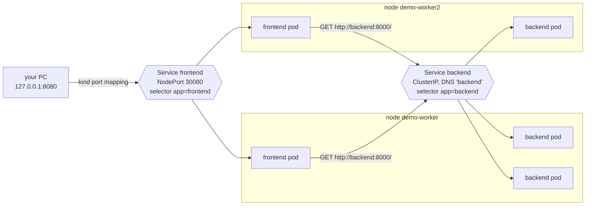

# hello-demo: multi-node Kubernetes app

Case study, part 2. A local Kubernetes cluster with 3 nodes (1 control plane and 2 workers, created with [kind](https://kind.sigs.k8s.io/)) runs two small FastAPI services. Their pods are spread over both workers, they talk to each other through a Kubernetes Service, and both can be updated without downtime.

## Assignment checklist

| Requirement | Where |
|---|---|
| Kubernetes cluster with at least two nodes | [kind-config.yaml](kind-config.yaml): 1 control plane + 2 workers |
| Application with components running on multiple nodes | [k8s/](k8s/): `topologySpreadConstraints` spread the replicas over both workers |
| Parts of the application communicate with each other | [frontend/app.py](frontend/app.py) calls the backend through the Service `backend` |
| Definition of the cluster and the application (code + description) | this README, [backend/](backend/), [frontend/](frontend/), [k8s/](k8s/) |
| Basic parts of a Kubernetes cluster | [docs/answers.md#1](docs/answers.md#1-what-are-the-basic-parts-of-a-kubernetes-cluster) |
| Kubernetes vs Red Hat OpenShift | [docs/answers.md#2](docs/answers.md#2-how-does-a-kubernetes-cluster-differ-from-red-hat-openshift) |
| Deployment from the repository to the cluster | [docs/answers.md#3](docs/answers.md#3-how-would-the-application-be-deployed-from-the-repository-to-the-cluster), [.github/workflows/ci.yaml](.github/workflows/ci.yaml) |
| Rolling update across pods and nodes | [docs/answers.md#4](docs/answers.md#4-how-would-a-rolling-update-be-realized), demo below (`make update`, `make rollback`) |

## Architecture



The control-plane node (API server, etcd, scheduler, controller manager) has a taint, so the application runs only on the two workers.

This follows Figure 1 of the assignment. **Service A** is `frontend` (exposed as a NodePort) and **Service B** is `backend` (an internal ClusterIP). Each Service selects its pods by the `app` label. A `topologySpreadConstraint` places the replicas on different nodes.

| Component | Replicas | Endpoint | Returns |
|---|---|---|---|
| `backend` | 3 | `GET /`, `GET /health` | `{service, version, pod, node}` |
| `frontend` | 2 | `GET /`, `GET /health` | own `{service, version, pod, node}` plus the backend's reply under `backend`; **503** if the backend is unreachable |

The pod and node names come from the Downward API. The version is baked into the image at build time (`--build-arg APP_VERSION`), so every response shows where it was served and by which version.

## Repository layout

```
kind-config.yaml          cluster definition: 1 control-plane + 2 workers, host port 8080 -> NodePort 30080
Makefile                  all commands used below
backend/                  app.py, test_app.py, Dockerfile, requirements.txt
frontend/                 app.py, test_app.py, Dockerfile, requirements.txt
k8s/backend.yaml          Deployment + ClusterIP Service
k8s/frontend.yaml         Deployment + NodePort Service
scripts/watch.py          polls the frontend and prints which backend version/pod answered
tests/smoke/              tests against the running cluster (nodes, spreading, communication, zero-downtime rollout)
.github/workflows/ci.yaml test -> build -> push image (deploy step sketched)
docs/answers.md           answers to the assignment questions
```

## Prerequisites

Docker (Docker Desktop on Windows/macOS), [kind](https://kind.sigs.k8s.io/docs/user/quick-start/#installation), [kubectl](https://kubernetes.io/docs/tasks/tools/), GNU make and Python 3.11+.

```bash
# Windows: winget install Docker.DockerDesktop Kubernetes.kind Kubernetes.kubectl ezwinports.make
python -m venv .venv
source .venv/bin/activate         # Windows: .\.venv\Scripts\Activate.ps1
pip install -r requirements-dev.txt
```

## Run it

```bash
make test                     # unit tests (5)
make cluster                  # create the 3-node kind cluster
make build load               # build v1 images and load them into the kind nodes
make deploy                   # kubectl apply -f k8s/ and wait for the rollout
make status                   # nodes, deployments, services, pods with their node
curl http://127.0.0.1:8080/   # repeat: different frontend/backend pods and nodes answer
make smoke                    # smoke tests against the running cluster
```

Example response:

```json
{"service":"frontend","version":"v1","pod":"frontend-5c4ff88bdc-x48fg","node":"demo-worker",
 "backend":{"service":"backend","version":"v1","pod":"backend-bfdc69f96-m6r28","node":"demo-worker"}}
```

Use `127.0.0.1` rather than `localhost` on Windows. `localhost` is tried as IPv6 first and the kind port mapping only listens on IPv4, which adds about 2 s to every request.

## Rolling update and rollback

Open two terminals:

```bash
make watch        # terminal 1: one line per request, error summary on Ctrl+C
make update       # terminal 2: build + load v2, `kubectl set image`, wait for the rollout
make rollback     # terminal 2: `kubectl rollout undo` back to v1
```

In terminal 1, v1 and v2 answer side by side for about 30 s, then only v2 answers. There are no errors. Measured result: 309 requests during the update and 130 during the rollback, 0 failed. `tests/smoke/test_rolling_update.py` checks the same behaviour automatically. Run it after `make update`, because it needs both image versions in the cluster.

How it works and which manifest settings make it work: [docs/answers.md, question 4](docs/answers.md#4-how-would-a-rolling-update-be-realized).

## Clean up

```bash
make clean        # kind delete cluster
```
